# DelphiLens

**A primary-source evidence miner for the [Delphi Agent Arena: Evidence Mining](https://agent-competition.gensyn.ai) competition, built on the official [Gensyn Delphi SDK](https://github.com/gensyn-ai/gensyn-delphi-sdk).**

DelphiLens reads the competition's prediction markets and searches for fresh, dated facts from primary sources. It checks each fact with an LLM and writes a short objective note, then submits it to Delphi through the SDK's `EvidenceClient`. It follows the competition rules on its own: one direction per market, max 3 submissions, no repeats, public sources only. Everything runs locally, with a command center dashboard and a daily digest.


---

## How it works

```mermaid
flowchart LR
    A[Competition markets<br/>markets.json or SDK] --> B[Prioritizer<br/>contested, untouched, big pots]
    B --> C[Researcher<br/>queries, search, date filter]
    C --> D[Fetcher<br/>robots.txt, clean text, snapshots]
    D --> E[LLM verifier<br/>public, verifiable, moves odds]
    E --> F[Guardrails<br/>stance lock, caps, dedupe]
    F --> G{Auto-submit?}
    G -- no --> H[Dashboard review]
    G -- yes --> I[EvidenceClient.submitEvidence]
    H --> I
    I --> J[Receipts<br/>verdict, rationale, USDC.e]
    J --> K[Digest and feedback log]
```



1. **Pick markets.** Until you qualify (10 judged submissions across 3 markets), DelphiLens spreads across untouched markets first. After that it favors contested markets (20% to 80%) with the biggest reward pots.
2. **Mine.** Each question becomes targeted queries for official releases, filings, commits, statistics and local news. Paywalled, stale and post-cutoff results are dropped, and primary sources rank first.
3. **Verify.** An LLM checks that each fact is public, verifiable and likely to move the forecaster, gives its direction (YES or NO), and picks the sentence that states it. That sentence is only kept if it appears word for word in the source.
4. **Skip repeats.** Delphi counts facts, not links, so each fact is compared with everything already drafted or sent on the market. A reworded or re-sourced repeat is dropped.
5. **Choose a side.** All passing evidence is weighed before committing. One side must clearly outweigh the other (by 1.5x), otherwise the market is left alone, because the settlement reward only pays when the evidence pointed toward the real outcome.
6. **Write the note.** One 2 to 3 sentence summary is written from all the chosen sources. The judge only reads what is submitted, so each source's key sentence is quoted underneath it with its publisher, date and link.
7. **Guard.** The stance lock, the 3-submission cap, the 3-file cap and the duplicate blocker run locally. Before sending, Delphi's own `getEntryState` and `listSubmissions` are checked too.
8. **Submit and track.** Drafts are sent with the source links and up to 3 markdown snapshots. Verdicts, rationales and rewards are polled and stored.

## Features

| | |
| --- | --- |
| **Official SDK** | `@gensyn-ai/gensyn-delphi-sdk` 2.4: `submitEvidence`, `getSubmission`, `listSubmissions`, `getEntryState`, `getTerms`, idempotent retries |
| **Agent identity** | `X-Agent-Id: DelphiLens`, `X-Agent-Harness` and `X-Agent-Model` on every request; `AGENT_ID` is locked |
| **Mock mode** | Offline markets, search, LLM and judge, so everything can be tested before 25 November |
| **Safety** | Live mode refuses to run without real search and LLM keys, so mock evidence can never be submitted |
| **Guardrails** | No self-contradiction, max 3 per market, max 3 files, URL and claim dedupe, same-fact check, qualification prioritizer |
| **Judge-ready notes** | Summary plus word-for-word quotes with publisher, date and link, so the judge sees the evidence even when it cannot open a page |
| **Stance by weight of evidence** | YES and NO evidence weighed by confidence before a market's side is locked; mixed markets are skipped |
| **First to new markets** | Checks for new markets every 5 minutes and mines them first |
| **Research** | Tavily news search, OpenAI-compatible LLM (OpenAI, OpenRouter, Groq, Gemini...), robots.txt-aware fetching |
| **Dashboard** | Overview, Live markets (Mine Now), Review & receipts, Newsletter & feedback, in the Sack of Chaos palette with dark and light modes |
| **Digest** | Daily markdown and HTML briefing in `reports/`, optionally sent by Discord webhook or email |
| **Feedback log** | API errors, rate limits, ambiguous markets and tool limits, exported for the feedback bounties |

## Quick start (Ubuntu / WSL)

You need **Node.js 22 or newer**.

```bash
# 1. Node 22 (skip if `node -v` already shows v22+)
nvm install 22 && nvm use 22

# 2. Get the code
git clone https://github.com/Black-Samson/DelphiLens.git
cd DelphiLens
npm install
cp .env.example .env

# 3. Check everything works
npm run check

# 4. Open the dashboard (mock mode)
npm run dashboard
```

If `npm install` fails while building `better-sqlite3`, install the compiler tools and try again:

```bash
sudo apt update && sudo apt install -y build-essential python3
npm install
```

Then open **http://localhost:8501** in your browser. Go to *Live markets*, press **Mine now**, review the draft in *Review & receipts*, and press **Approve & submit**. In mock mode, a fake judge returns a verdict after about 5 seconds.

To run the agent on a loop, open a second terminal:

```bash
npm run worker
```

## Troubleshooting

**"Live mode is on ... but .env is missing ..."**: live mode was switched on before the keys were added. Go back to mock mode:

```bash
npm start -- mock on
```

Also check that `.env` says `MOCK_MODE=true` until 25 November.

## Going live on 25 November

See **[docs/GO_LIVE.md](docs/GO_LIVE.md)**. In short: add your Delphi API key, set the evidence base URL and market list from the agent guide, read and accept the evidence terms, and set `MOCK_MODE=false`.

## Commands

| Command | What it does |
| --- | --- |
| `npm run dashboard` | Command center at http://localhost:8501 |
| `npm run worker` | Background loop: refresh markets, mine, submit (if auto), poll, daily digest |
| `npm start -- status` | Mode, qualification progress, earnings |
| `npm start -- markets` | Refresh and list open markets |
| `npm start -- mine [marketId]` | Mine evidence for the best market, or the one given |
| `npm start -- drafts` | List drafts waiting for approval |
| `npm start -- approve <id>` / `discard <id>` | Submit or throw away a draft |
| `npm start -- poll` | Check verdicts and rewards |
| `npm start -- digest [--send]` | Write today's digest, and optionally send it |
| `npm start -- feedback` | Export `reports/feedback_bounty_notes.md` |
| `npm start -- terms [--accept <v>]` | Show the evidence terms, or accept a version you have read |
| `npm start -- mock on` / `mock off` | Switch mock mode (overrides `MOCK_MODE` in `.env`) |
| `npm run check` | Lint, type-check and run all tests |

The `Makefile` has the same shortcuts (`make dashboard`, `make worker`, `make check`...).

## Configuration

All settings live in `.env`. `.env.example` documents every one.

| Variable | Purpose |
| --- | --- |
| `AGENT_ID` | Locked to `DelphiLens` |
| `AGENT_HARNESS`, `AGENT_MODEL` | Sent as `X-Agent-Harness` and `X-Agent-Model` |
| `MOCK_MODE` | `true` runs offline; `false` uses the real Delphi API |
| `AUTO_SUBMIT` | `false` queues drafts for your approval |
| `DELPHI_API_ACCESS_KEY` | Your Delphi API key (from 25 November) |
| `DELPHI_EVIDENCE_BASE_URL` | Evidence API base URL, ending in `/v1` |
| `MARKETS_SOURCE`, `MARKETS_URL` | `url` for the competition `markets.json`, or `sdk` |
| `SEARCH_API_KEY` | Tavily key |
| `LLM_BASE_URL`, `LLM_API_KEY`, `LLM_MODEL` | Any OpenAI-compatible chat API |
| `MAX_SOURCE_AGE_DAYS` | Freshness window for sources (default 14) |
| `WORKER_INTERVAL_MINUTES` | Time between full worker cycles (default 30) |
| `MARKET_POLL_MINUTES` | How often to check for new markets between cycles (default 5) |
| `DISCORD_WEBHOOK_URL`, `SMTP_*`, `DIGEST_EMAIL_*` | Optional digest delivery |

## Project structure

```
src/
  config.ts            settings, locked agent identity
  db.ts                SQLite schema (markets, stance locks, submissions, hashes, feedback)
  guardrails.ts        stance lock, caps, dedupe, qualification, prioritizer
  markets/             mock markets, markets.json normalizer, SDK source, store
  evidence/            SDK EvidenceClient factory and offline mock
  research/            search, queries, source ranking, fetcher, LLM, verifier, same-fact check, notes, snapshots, miner
  submitter.ts         submit drafts, poll receipts
  stats.ts             earnings and acceptance stats
  newsletter.ts        daily digest (markdown + HTML)
  delivery.ts          Discord webhook and SMTP email
  feedback.ts          feedback bounty log
  worker.ts            background loop
  server.ts            localhost dashboard API
  cli.ts               command-line interface
web/                   dashboard (HTML, CSS, JS)
tests/                 Vitest suite
docs/GO_LIVE.md        November 25 checklist
data/                  SQLite database and snapshots (git-ignored)
reports/               digests and feedback notes (git-ignored)
```

## Testing

```bash
npm run check   # eslint + tsc + vitest
npm test        # tests only
```

The suite covers the stance lock, the duplicate blocker, the 3-submission and 3-file caps, qualification, the market normalizer, the SDK headers, research filtering, LLM verification, the miner, the submitter, the newsletter, delivery, the feedback log, the worker and the dashboard API. GitHub Actions runs it on every push.

## Competition rules DelphiLens respects

- **One direction per market.** Evidence for both sides cancels out, so after the first draft the market is locked to that stance.
- **Up to 3 submissions per market, up to 3 files each.**
- **No repeats.** Repeated evidence earns nothing. Links and claims are hashed, and your account's earlier submissions are checked before sending.
- **Public information only.** Known paywalls are skipped, robots.txt is respected, and the LLM rejects private, leaked or personal data.
- **Real evidence only.** Notes are written from the fetched source text, and live mode cannot use mock research.

## Security

- `.env` holds your keys and is git-ignored. Never commit it.
- The dashboard listens on `127.0.0.1` only, because it can submit evidence.
- DelphiLens never accepts Delphi's terms for you. You read them and run `terms --accept` yourself.

## License

MIT
